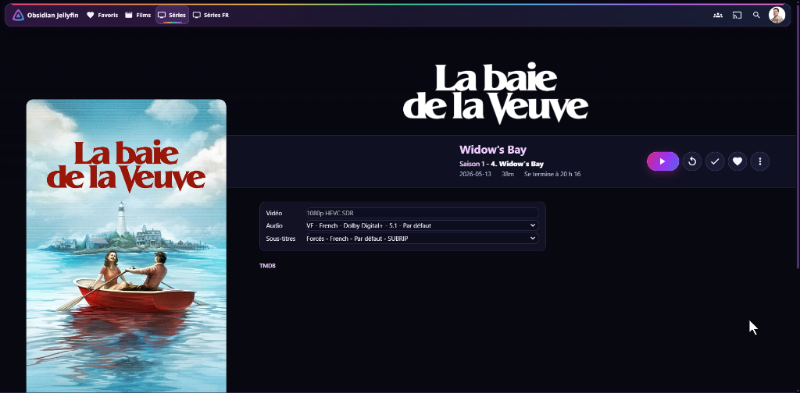

<div align="center">

# 🏳️‍🌈 Jellyfin Obsidian Pride

**A sleek, high-performance OLED dark theme with Progress Pride cinema accents for Jellyfin 12.**

[](https://jellyfin.org)
[](https://github.com/MathieuLF/jellyfin-obsidian-pride)
[](LICENSE)
[](#features)

<br/>



</div>

---

## ✨ Features

- **🖤 Obsidian Velvet Canvas (`#070811` → `#161a30`)**: Deep blacks tuned for OLED displays and cinema HDR contrast, with WCAG AAA typography (`#f7f4ff` primary, `#bcc3df` secondary).
- **🏳️‍🌈 Progress Pride Palette**: Sophisticated, queer-cinema editorial accents (trans sky blue, lavender, rose, magenta, amber, emerald) without washed-out pastels or fatiguing neon.
- **⚡ 60 FPS Butter-Smooth Scrolling**:
  - **Zero `:has()` selectors**: Eliminates expensive DOM style recalculations over massive libraries (20,000+ items).
  - **Zero GPU jank**: No `backdrop-filter` or blur on scrolling cards or progress bars.
  - **100% Offline & Private**: Zero external font calls (`@import`), zero remote tracking scripts, pure local CSS.
- **📱 True Cross-Device Matrix**:
  - **Mobile (`< 640px`)**: Full notch & safe-area inset support (`env(safe-area-inset-*)`), thumb-friendly $\ge 44\text{px}$ touch targets, responsive episode rows.
  - **Tablet (iPads 768–1024px)**: Fixes long-standing title clipping and layout overflow bugs.
  - **Desktop & Ultrawide**: Balanced 3-column library showcase, subtle fine-pointer hover lifts, and elegant left alignment.
  - **Smart TV (10-Foot UI)**: High-visibility D-pad remote focus rings (`3.5px solid #f7ccff` + glowing halo) for LG webOS, Samsung Tizen, Android TV, and HTPCs.
- **🎬 Cinema Detail View & Fixes**:
  - **Fixed Jellyfin 12 desktop float offset bug**: Titles, metadata, and action buttons align cleanly on the `32.45vw` axis next to the poster.
  - **Uniform Tech Specs Panel**: Version, Video (`1080p HEVC SDR`), Audio, and Subtitles share matching heights (`36px`) and symmetrical alignments.
  - **Branded Link Badges**: Elegant interactive pill badges for **TMDB**, **IMDb**, **Trakt**, **TheTVDB**, and Official Websites.
  - **Video OSD Scrubber**: High-contrast, tactile white scrubber thumb with Pride glow halo.

---

## 🚀 Quick Install (1 Click)

1. Open your **Jellyfin Dashboard** (`Admin` $\rightarrow$ `Dashboard`).
2. Navigate to **General** $\rightarrow$ **Branding**.
3. In the **Custom CSS code** textarea, add:

```css
@import url("https://cdn.jsdelivr.net/gh/MathieuLF/jellyfin-obsidian-pride@main/theme.css");
```

4. Click **Save**, then hard-refresh your browser (`Ctrl + F5` or `Cmd + Shift + R`).

> [!TIP]
> **Alternative (Offline / Self-Hosted without CDN)**:
> You can also copy the raw content of [`theme.css`](theme.css) and paste it directly into the **Custom CSS code** box.

---

## 🎨 Optional Customizations

### Custom Library Folder Covers
To display custom full-bleed cover art on your Home screen library folders (*Films*, *Séries*, etc.), append this to your Custom CSS box below the `@import`:

```css
/* Replace YOUR_ITEM_ID with the ID of your CollectionFolder */
.card[data-id="YOUR_ITEM_ID"] .cardImageContainer {
  background-image: url("/Items/YOUR_ITEM_ID/Images/Primary") !important;
  background-size: cover !important;
  background-position: center !important;
}

.card[data-id="YOUR_ITEM_ID"] .cardImageIcon {
  display: none !important;
}
```

### Color Overrides
You can easily adjust the main accent color by overriding the CSS variables in `:root`:

```css
:root {
  --accent-main: #b77cff;   /* Main orchid purple accent */
  --accent-rose: #ff63a8;   /* Secondary rose-magenta */
  --focus-ring:  #f5c2ff;   /* Focus outline color */
}
```

---

## 📺 Client Compatibility

| Client | Supported | Notes |
| :--- | :---: | :--- |
| **Web Browsers** (Chrome, Firefox, Safari, Edge) | ✅ **100%** | Full support across desktop, tablet, and mobile. |
| **Jellyfin Mobile App** (iOS / Android) | ✅ **100%** | Native WebView client automatically inherits custom CSS. |
| **Jellyfin Media Player** (Windows, macOS, Linux) | ✅ **100%** | Full support. |
| **Smart TV Web Apps** (LG webOS, Samsung Tizen) | ✅ **100%** | Tested with D-pad navigation and 10-foot typography. |
| *Swiftfin (Apple TV)* / *Roku* | ❌ | Native OS clients do not render web CSS. |

---

## 📄 License

Distributed under the **MIT License**. See [`LICENSE`](LICENSE) for details.

Developed with 💜 by [MathieuLF](https://github.com/MathieuLF).
